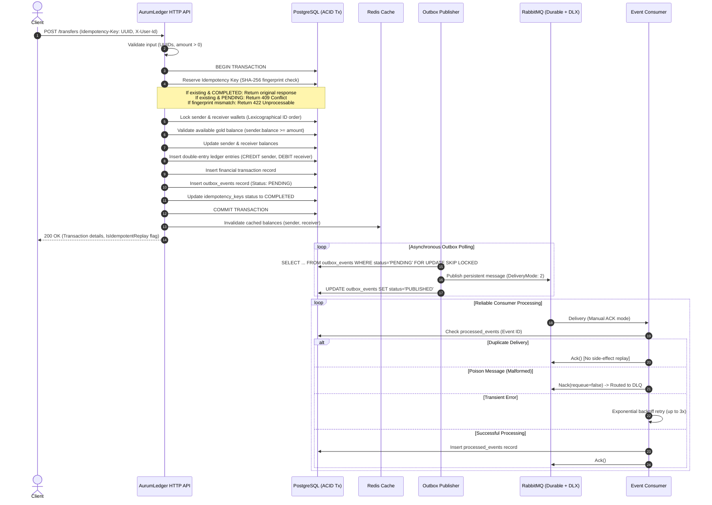

<div align="center">

# AurumLedger

### Production-Grade High-Concurrency Digital Gold Wallet & Double-Entry Accounting Engine

[](https://go.dev/)
[](https://www.postgresql.org/)
[](https://www.rabbitmq.com/)
[](https://redis.io/)
[](#interactive-fintech-cockpit-frontend-ui)
[](#system-architecture--lifecycle-flow)

*An auditable, concurrency-safe digital asset transfer service engineered in Go, implementing persistent idempotency, immutable double-entry ledger bookkeeping, transactional outbox publishing with PostgreSQL `SKIP LOCKED`, live gold rate tallying (INR ₹), and resilient message processing with Dead-Letter Queues.*

</div>

---

## Table of Contents

- [Interactive Fintech Cockpit (Frontend UI)](#interactive-fintech-cockpit-frontend-ui)
- [Core Engineering Priorities](#core-engineering-priorities)
- [System Architecture & Lifecycle Flow](#system-architecture--lifecycle-flow)
- [Detailed Priority Implementations](#detailed-priority-implementations)
  - [Priority 1: Persistent Idempotency](#priority-1-persistent-idempotency)
  - [Priority 2: Double-Entry Ledger Accounting](#priority-2-double-entry-ledger-accounting)
  - [Priority 3: Transactional Outbox Pattern](#priority-3-transactional-outbox-pattern)
  - [Priority 4: Reliable Failure Handling & Dead-Letter Queues](#priority-4-reliable-failure-handling--dead-letter-queues)
- [Deterministic Deadlock Prevention](#deterministic-deadlock-prevention)
- [Technology Stack](#technology-stack)
- [Getting Started](#getting-started)
  - [Prerequisites](#prerequisites)
  - [Docker Compose (Single Command)](#docker-compose-single-command)
  - [Running Tests](#running-tests)
- [API Reference](#api-reference)
- [System Design Decisions & Architectural Invariants](#system-design-decisions--architectural-invariants)

---

## Interactive Fintech Cockpit (Frontend UI)

AurumLedger includes an **interactive banking cockpit** served directly at `http://localhost:8080/dashboard` and `http://localhost:8080/` (embedded into the Go binary via `//go:embed`, requiring zero Node.js/npm dependencies).

### Cockpit Capabilities:
- **Clean Human Design**: Crisp geometric SVG vector icons and customer initials avatar badges (`AS`, `BP`, `CV`, `DS`, `GT`) with zero clipboard emojis.
- **Light Theme (Default) & Dark Theme**: High-contrast porcelain & warm gold Light Theme by default, with a 1-click theme toggle in the top bar.
- **Live Gold & INR (₹) Rate Tally**: Synchronized rate tracking (24K Gold at ₹7,850.00 / gram = ₹7.85 / milligram) with real-time bidirectional currency conversion during transfers.
- **Multi-User Account Switcher (Gullak FinTech Context)**: 1-click active session switching between Alice Sharma (Daily Saver), Bob Patel (Investor), Charlie Verma (Gold Lease Partner), Diana Singh (Merchant), and Gullak Treasury Vault.
- **Digital Gold Transfer Console**: Execute peer-to-peer 24K gold transfers bound to the active user's session with auto-generated receipt ID (`Idempotency-Key`) protection.
- **Built-in Security Verification (403 Forbidden)**: Test authorization boundaries by attempting to transfer from an unauthenticated wallet.
- **Instant Idempotency Replay Lab**: Replay transaction keys to observe duplicate prevention without double-spending.
- **Tampering Rejection**: Verify payload mismatch rejection (422 Unprocessable Entity) when amounts or recipients are modified on reused keys.
- **10x Concurrency Stress Test**: Trigger 10 simultaneous transfers with row locks to prove zero deadlocks and zero balance drift.
- **Live Double-Entry Ledger Stream**: Real-time immutable `CREDIT (+)` and `DEBIT (-)` accounting records.
- **Transactional Outbox Inspector**: Inspect asynchronously published events queued in PostgreSQL.
- **One-Click Vault Reconciliation**: Trigger an on-demand audit mathematically verifying that $\sum \text{Debits} == \sum \text{Credits}$.

---

## Core Engineering Priorities

AurumLedger was designed around four mandatory backend financial engineering requirements. These features are not isolated proofs-of-concept; they are unified into the core gold transfer lifecycle:

| Priority | Feature | Threat Mitigated | Technical Mechanism |
| :--- | :--- | :--- | :--- |
| **1** | **Persistent Idempotency** | Double transfers during client retries / timeouts | PostgreSQL `idempotency_keys` table, compound unique constraint `(user_id, key)`, SHA-256 payload fingerprinting, state reservation. |
| **2** | **Double-Entry Ledger Accounting** | Silent balance corruption & balance-sheet drift | Immutable append-only `ledger_entries`, paired `DEBIT`/`CREDIT` records per transfer, mathematical reconciliation engine. |
| **3** | **Transactional Outbox Pattern** | Lost messages due to dual-write database/broker failures | Atomically committed `outbox_events` in PostgreSQL, autonomous publisher using `SELECT FOR UPDATE SKIP LOCKED`, durable queues. |
| **4** | **Reliable Consumer & Failure Handling** | Poison pills, silent drops & duplicate side-effects | Manual acknowledgements (`auto-ack: false`), `processed_events` deduplication table, exponential backoff retries, Dead-Letter Exchange (DLX/DLQ). |

---

## System Architecture & Lifecycle Flow

Every gold transfer follows an exact 15-step financial execution pipeline:



---

## Detailed Priority Implementations

### Priority 1: Persistent Idempotency

When clients experience timeouts, drops, or uncertain HTTP responses, retry storms can drain accounts or duplicate transfers.

1. **Database-Level Constraint**:
   - `idempotency_keys` table enforces a compound unique constraint:
     ```sql
     CREATE UNIQUE INDEX idx_user_key ON idempotency_keys(user_id, key);
     ```
2. **Payload Fingerprinting**:
   - A cryptographic SHA-256 hash is computed over normalized request fields:
     $$\text{Fingerprint} = \text{SHA256}(\text{sender\_id} \parallel \text{receiver\_id} \parallel \text{amount})$$
   - If an idempotency key is reused with a different amount or receiver, the transaction is rejected with `422 Unprocessable Entity` (`ErrIdempotencyPayloadMismatch`).
3. **Atomic State Machine**:
   - `PENDING`: Request is currently being processed. Concurrent requests with the same key receive `409 Conflict` (`ErrIdempotencyConflict`).
   - `COMPLETED`: Previous request succeeded. Returns the cached original transaction response payload without mutating financial balances.

---

### Priority 2: Double-Entry Ledger Accounting

A mutable balance field on an account is insufficient for institutional-grade financial systems. AurumLedger separates mutable wallet balances from permanent, immutable accounting entries.

1. **Balanced Entries**:
   - For every transfer of $X$ milligrams of gold:
     - **Sender Entry**: Type = `CREDIT` (Gold asset decrease), Amount = $X$, BalanceAfter = $\text{SenderBalance}_{t+1}$.
     - **Receiver Entry**: Type = `DEBIT` (Gold asset increase), Amount = $X$, BalanceAfter = $\text{ReceiverBalance}_{t+1}$.
   - System Invariant:
     $$\sum \text{Debits} - \sum \text{Credits} = 0$$
2. **Immutability**:
   - Ledger records are append-only. No `UPDATE` or `DELETE` operations are ever executed against `ledger_entries`.
3. **Audit & Reconciliation Engine**:
   - AurumLedger exposes a dedicated reconciliation engine (`ReconciliationService` / `POST /reconcile`):
     - Calculates ledger-derived balance for each wallet: $\sum \text{Debits} - \sum \text{Credits}$.
     - Compares derived balance against current `wallet.balance`.
     - Detects anomalies, discrepancies, and balance-sheet tampering.

---

### Priority 3: Transactional Outbox Pattern

The classic "Dual-Write" trap:

```
❌ Bad Practice:
db.Commit() ──> mq.Publish() ──> Crashes before publish = Lost event forever!
```

AurumLedger eliminates this risk by co-locating financial state mutations and message creation within the **same ACID transaction**:

1. **Outbox Schema**:
   - `outbox_events` table contains `id`, `aggregate_type`, `aggregate_id`, `event_type`, `payload`, `status` (`PENDING`, `PROCESSING`, `PUBLISHED`, `FAILED`), and `retry_count`.
2. **Autonomous Publisher with `SKIP LOCKED`**:
   - A background publisher polls pending outbox events using PostgreSQL:
     ```sql
     SELECT * FROM outbox_events 
     WHERE status = 'PENDING' 
     ORDER BY created_at ASC 
     LIMIT 50 
     FOR UPDATE SKIP LOCKED;
     ```
   - **Horizontal Scalability**: Multiple publisher instances run across Kubernetes pods without lock contention or duplicate publishing.
3. **At-Least-Once Delivery**:
   - The publisher confirms publication with RabbitMQ (`PublishWithDeferredConfirm`) before marking the event `PUBLISHED`.
   - If the publisher crashes after publishing but before updating the database, the event is re-published on restart and safely deduplicated by the consumer.

---

### Priority 4: Reliable Failure Handling & Dead-Letter Queues

1. **Topology**:
   - **Main Exchange**: `aurumledger.events` (Direct, Durable).
   - **Main Queue**: `aurumledger.wallet_transfers` (Durable, persistent disk-backed messages).
   - **Dead-Letter Exchange (DLX)**: `aurumledger.dlx` (Direct, Durable).
   - **Dead-Letter Queue (DLQ)**: `aurumledger.wallet_transfers.dlq` (Durable).
2. **Dead-Letter Routing**:
   - The main queue is configured with RabbitMQ dead-letter headers:
     ```go
     amqp.Table{
         "x-dead-letter-exchange":    "aurumledger.dlx",
         "x-dead-letter-routing-key": "transfer.dlq",
     }
     ```
3. **Poison Message Defense**:
   - Malformed JSON payloads or schema violations are negatively acknowledged with `requeue = false`:
     `d.Nack(false, false)` $\rightarrow$ automatically diverted to the DLQ.
   - Prevents head-of-line blocking and worker crashes.
4. **Idempotent Consumer Deduplication**:
   - The consumer tracks processed message IDs in the PostgreSQL `processed_events` table:
     ```sql
     CREATE TABLE processed_events (
         event_id UUID PRIMARY KEY,
         event_type VARCHAR(50) NOT NULL,
         consumer_name VARCHAR(50) NOT NULL,
         processed_at TIMESTAMPTZ NOT NULL,
         status VARCHAR(20) NOT NULL
     );
     ```
   - When duplicate deliveries occur, the consumer ACKs immediately without repeating financial side effects.
5. **Transient Retries with Exponential Backoff**:
   - Transient errors (e.g. temporary database timeout) trigger up to 3 retries with exponential backoff ($100\text{ms} \rightarrow 200\text{ms} \rightarrow 400\text{ms}$).

---

## Deterministic Deadlock Prevention

### The Problem
When two clients concurrently initiate reverse transfers between the same wallets:
- **Transaction 1**: Wallet A $\rightarrow$ Wallet B (Locks A, waits for B)
- **Transaction 2**: Wallet B $\rightarrow$ Wallet A (Locks B, waits for A)
- **Result**: PostgreSQL Deadlock! (`ERROR: deadlock detected (40P01)`)

### The AurumLedger Solution: $O(1)$ Lexicographical Lock Ordering
Before acquiring row locks with `SELECT FOR UPDATE`, AurumLedger sorts the wallet UUIDs:

```go
// Deadlock Prevention: Deterministic Lock Acquisition Order
firstID, secondID := senderID, receiverID
if firstID.String() > secondID.String() {
    firstID, secondID = receiverID, senderID
}

// Always acquire lock on firstID before secondID
w1, err := s.walletRepo.GetByIDWithLock(ctx, tx, firstID)
w2, err := s.walletRepo.GetByIDWithLock(ctx, tx, secondID)
```

Because all transactions across all goroutines acquire locks in the exact same global order, **deadlocks are mathematically impossible**.

---

## Technology Stack

- **Language**: Go 1.23+ (`net/http` enhanced routing, standard library concurrency primitives)
- **Database**: PostgreSQL 16 (Driver: `pgx/v5`, ORM: `GORM v1.25`)
- **Message Broker**: RabbitMQ 3.13 (`amqp091-go` with publisher confirms & DLX/DLQ)
- **Cache Layer**: Redis 7 (`go-redis/v9` with cache-aside)
- **Validation**: `go-playground/validator/v10`
- **Testing**: Pure Go in-memory SQLite harness + integration test suite

---

## Getting Started

### Prerequisites

- Go 1.22+ or Docker & Docker Compose

### Docker Compose (Single Command)

Spin up PostgreSQL, Redis, RabbitMQ, and the AurumLedger API server with health-checked orchestration:

```bash
docker compose up -d --build
```

The dashboard will be reachable at `http://localhost:8080/dashboard` (or `http://localhost:8080/`).
The RabbitMQ Management Dashboard will be accessible at `http://localhost:15672` (User: `guest`, Pass: `guest`).

### Running Tests

The test suite contains automated tests verifying all 4 priorities:

```bash
# Run all tests with verbose output
go test -v -mod=vendor ./tests/...
```

#### Test Suite Breakdown

| Test File | Test Case | Focus |
| :--- | :--- | :--- |
| `idempotency_test.go` | `TestIdempotentTransfer_SameRequestMultipleTimes` | Verify gold is transferred exactly once on retries |
| `idempotency_test.go` | `TestIdempotentTransfer_ConcurrentDuplicateRequests` | Race condition protection on identical keys |
| `idempotency_test.go` | `TestIdempotentTransfer_NetworkTimeoutRetry` | Client retry returns original transaction |
| `idempotency_test.go` | `TestIdempotentTransfer_PayloadMismatchRejection` | Reject key reuse with altered amount/receiver |
| `ledger_test.go` | `TestDoubleEntryLedger_BalancedEntries` | Paired DEBIT/CREDIT records created per transaction |
| `ledger_test.go` | `TestDoubleEntryLedger_FailedTransferNoPartialRecords` | Atomic rollback on insufficient funds |
| `ledger_test.go` | `TestDoubleEntryLedger_ConcurrentTransfersPreserveInvariants` | Total gold conserved across concurrent transfers |
| `ledger_test.go` | `TestDoubleEntryLedger_ReconciliationDetectsInconsistency` | Audit flags tampered database balances |
| `outbox_test.go` | `TestOutbox_AtomicWithTransfer` | Outbox event created in same DB transaction |
| `outbox_test.go` | `TestOutbox_RabbitMQUnavailableRetries` | Transfer succeeds when broker is offline |
| `outbox_test.go` | `TestOutbox_ApplicationRestartRecoversPendingEvents` | Crash recovery of pending events on boot |
| `outbox_test.go` | `TestOutbox_MultiplePublishersConcurrencySafe` | `SKIP LOCKED` prevents duplicate publishing |
| `consumer_test.go` | `TestConsumer_IdempotentDuplicateDelivery` | Dedupes redelivered messages safely |
| `consumer_test.go` | `TestConsumer_PoisonMessageRoutedToDLQ` | Diverts malformed payloads to DLQ |
| `consumer_test.go` | `TestConsumer_RetryAndExponentialBackoff` | Transient errors retried with exponential backoff |
| `concurrency_test.go` | `TestConcurrentTransfers` | 50 concurrent goroutines stress testing lock ordering |
| `api_test.go` | `TestTransferAPI_IdempotencyAndLedger` | Full end-to-end HTTP API verification |

---

## API Reference

### 1. Health Check
`GET /health`
```json
{
  "service": "AurumLedger",
  "status": "UP",
  "version": "1.0.0"
}
```

### 2. Create Digital Gold Wallet
`POST /wallets`
```json
{
  "user_id": "550e8400-e29b-41d4-a716-446655440000",
  "initial_balance": 1000
}
```
*Note: `initial_balance` is in milligrams of fine 24K gold (1,000 mg = 1 gram).*

### 3. Get Wallet Balance
`GET /wallets/{id}`

### 4. Concurrency-Safe Gold Transfer
`POST /transfers`
- **Required Header**: `Idempotency-Key: <unique-uuid-or-string>`
- **Optional Header**: `X-User-Id: <sender-user-uuid>` (Authenticated user ID)

```json
{
  "sender_id": "c1f7a0b2-29f1-4df2-8c11-92b1a8d50001",
  "receiver_id": "d2e8b1c3-30e2-4ef3-9d22-03c2b9e60002",
  "amount": 250
}
```

**Success Response (`200 OK`)**:
```json
{
  "transaction": {
    "id": "e4f9c2d4-41f3-4ff4-ae33-14d3c0f70003",
    "sender_id": "c1f7a0b2-29f1-4df2-8c11-92b1a8d50001",
    "receiver_id": "d2e8b1c3-30e2-4ef3-9d22-03c2b9e60002",
    "amount": 250,
    "type": "TRANSFER",
    "status": "COMPLETED",
    "created_at": "2026-11-10T17:53:46Z"
  },
  "is_idempotent_replay": false,
  "sender_balance_after": 750,
  "receiver_balance_after": 250
}
```

### 5. Audit Ledger History
`GET /wallets/{id}/ledger`
Returns immutable audit trail entries with balance snapshots:
```json
{
  "wallet_id": "c1f7a0b2-29f1-4df2-8c11-92b1a8d50001",
  "count": 2,
  "entries": [
    {
      "id": "...",
      "transaction_id": "...",
      "entry_type": "DEBIT",
      "amount": 1000,
      "balance_after": 1000,
      "description": "Initial gold deposit"
    },
    {
      "id": "...",
      "transaction_id": "...",
      "entry_type": "CREDIT",
      "amount": 250,
      "balance_after": 750,
      "description": "Gold transfer outflow to wallet d2e8b1c3-..."
    }
  ]
}
```

### 6. System Reconciliation Audit
`POST /reconcile`
```json
{
  "total_wallets": 2,
  "matched_wallets": 2,
  "mismatched_wallets": 0,
  "system_total_balance": 1000,
  "system_total_debits": 1250,
  "system_total_credits": 250,
  "is_system_balanced": true,
  "audited_at": "2026-11-10T17:53:46Z"
}
```

---

## System Design Decisions & Architectural Invariants

The architecture of AurumLedger demonstrates deliberate technical trade-offs designed for high reliability, zero balance drift, and fault tolerance across distributed services:

### 1. Persistent Idempotency vs. In-Memory Caching
> **Architectural Decision**: Redis is leveraged for low-latency read caching, but idempotency records are persisted directly in PostgreSQL with compound unique constraints `(user_id, key)` inside the exact same database transaction as the financial transfer.
> **Rationale**: An in-memory cache can drop state during failovers, restarts, or network partitions, exposing financial balances to double-spend. Tying idempotency state to PostgreSQL's ACID transaction makes it mathematically impossible for a transfer to commit without reserving its idempotency key.

### 2. Double-Entry Accounting vs. Mutable Balance Columns
> **Architectural Decision**: Wallets maintain a balance snapshot, but every financial mutation generates immutable, paired `DEBIT (+)` and `CREDIT (-)` ledger records.
> **Rationale**: Storing only a mutable balance column (`balance = balance - X`) provides zero auditability. In the event of software faults or race conditions, paired ledger entries guarantee that $\sum \text{Debits} == \sum \text{Credits}$ across the ledger at all times, enabling automated mathematical reconciliation.

### 3. Transactional Outbox vs. Direct Message Publishing (Eliminating the Dual-Write Hazard)
> **Architectural Decision**: Events are written directly into an `outbox_events` table inside the transfer transaction. A background publisher asynchronously drains and forwards events to RabbitMQ.
> **Rationale**: Publishing directly to a message broker during an HTTP request creates a distributed dual-write hazard—if the database commits but the broker connection times out, events are permanently lost. With the Outbox pattern, database transactions commit reliably regardless of broker availability; the publisher retries with exponential backoff until the broker ACKs.

### 4. Horizontal Publisher Scaling via `SKIP LOCKED`
> **Architectural Decision**: The background outbox publisher uses PostgreSQL's `SELECT ... FOR UPDATE SKIP LOCKED` combined with an atomic claim state transition (`PENDING` $\rightarrow$ `PROCESSING`).
> **Rationale**: When multiple outbox publisher instances run concurrently across container pods, `SKIP LOCKED` instructs the database engine to skip rows locked by other instances, enabling linear horizontal scaling with zero lock contention and zero duplicate publishing.

### 5. Deterministic Lock Ordering for Deadlock Elimination
> **Architectural Decision**: Sender and receiver wallet UUIDs are ordered lexicographically before acquiring row locks (`SELECT ... FOR UPDATE`).
> **Rationale**: Simultaneous cross-transfers (e.g. Wallet A transferring to Wallet B while Wallet B transfers to Wallet A) naturally trigger cyclical deadlocks under naive locking. By enforcing deterministic lock acquisition order ($O(1)$ UUID comparison), wait-for graph cycles are mathematically eliminated.
